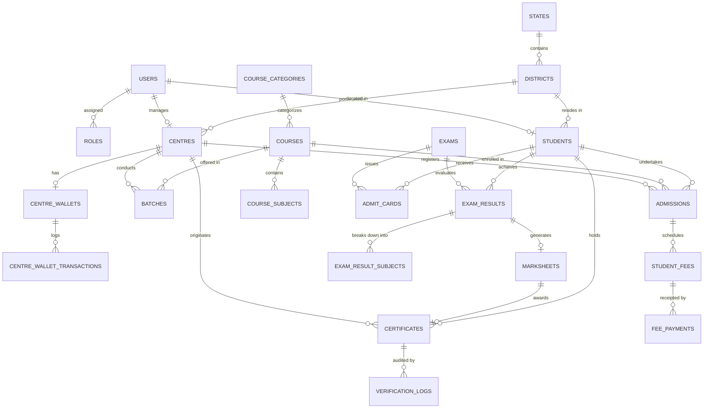

# Database Schema Specification: Drishti Computer Education

**Database Engine:** MySQL / MariaDB (InnoDB, `utf8mb4_unicode_ci`)  
**Target Database Name:** `frenchise` (as configured in `.env`)  
**Laravel Eloquent ORM Version:** 12.x Compatible  
**Status:** Architecture Blueprint

---

## 1. Entity-Relationship Overview



---

## 2. Table Schemas & Data Dictionaries

### 2.1. Authentication, Roles & RBAC

#### `users`
Central credentials and authentication account table.
| Column | Type | Attributes | Constraints / Description |
|---|---|---|---|
| `id` | BIGINT UNSIGNED | AUTO_INCREMENT, PRIMARY KEY | Unique user ID |
| `name` | VARCHAR(191) | NOT NULL | User's full name |
| `email` | VARCHAR(191) | UNIQUE, NOT NULL | Login email / contact email |
| `mobile` | VARCHAR(20) | UNIQUE, NULLABLE | Mobile phone number |
| `password` | VARCHAR(255) | NOT NULL | Bcrypt hashed password |
| `role` | ENUM | NOT NULL, DEFAULT 'student' | `'super_admin'`, `'admin'`, `'centre'`, `'staff'`, `'student'` |
| `is_active` | BOOLEAN | NOT NULL, DEFAULT 1 | 1 = Active, 0 = Suspended/Blocked |
| `email_verified_at`| TIMESTAMP | NULLABLE | Verification timestamp |
| `remember_token` | VARCHAR(100) | NULLABLE | Remember me session token |
| `created_at` | TIMESTAMP | NULLABLE | Creation timestamp |
| `updated_at` | TIMESTAMP | NULLABLE | Update timestamp |

#### `roles`
System roles for extensible authorization.
| Column | Type | Constraints / Description |
|---|---|---|
| `id` | BIGINT UNSIGNED | AUTO_INCREMENT, PRIMARY KEY |
| `slug` | VARCHAR(50) | UNIQUE, NOT NULL (e.g. `super_admin`, `admin`, `centre`, `staff`, `student`) |
| `name` | VARCHAR(100) | NOT NULL (e.g. `Super Administrator`, `Centre Franchisee`) |
| `description` | TEXT | NULLABLE |

#### `permissions`
Fine-grained capabilities for system modules.
| Column | Type | Constraints / Description |
|---|---|---|
| `id` | BIGINT UNSIGNED | AUTO_INCREMENT, PRIMARY KEY |
| `name` | VARCHAR(100) | UNIQUE, NOT NULL (e.g. `manage_centres`, `issue_certificates`) |
| `group_name`| VARCHAR(50) | NOT NULL (e.g. `academics`, `billing`, `students`) |

---

### 2.2. Geographic Masters

#### `states`
All 28 Indian States & 8 Union Territories.
| Column | Type | Constraints / Description |
|---|---|---|
| `id` | INT UNSIGNED | AUTO_INCREMENT, PRIMARY KEY |
| `name` | VARCHAR(100) | UNIQUE, NOT NULL |
| `code` | VARCHAR(10) | NULLABLE (e.g. `UP`, `BR`, `DL`) |
| `status` | BOOLEAN | DEFAULT 1 |

#### `districts`
Districts mapped under states for dependent dropdown filtering.
| Column | Type | Constraints / Description |
|---|---|---|
| `id` | INT UNSIGNED | AUTO_INCREMENT, PRIMARY KEY |
| `state_id` | INT UNSIGNED | FOREIGN KEY -> `states.id` ON DELETE CASCADE |
| `name` | VARCHAR(100) | NOT NULL, INDEXED |
| `status` | BOOLEAN | DEFAULT 1 |

---

### 2.3. Franchise / Centre Management

#### `centres`
Authorised Study Centres / Franchises.
| Column | Type | Attributes | Constraints / Description |
|---|---|---|---|
| `id` | BIGINT UNSIGNED | AUTO_INCREMENT, PRIMARY KEY | Primary Key |
| `user_id` | BIGINT UNSIGNED | UNIQUE, NULLABLE | FOREIGN KEY -> `users.id` ON DELETE SET NULL (Login account) |
| `centre_code` | VARCHAR(50) | UNIQUE, NOT NULL | Official Centre Code (e.g. `DCE-1001`, `DCE-1042`) |
| `centre_name` | VARCHAR(191) | NOT NULL | Institute/Centre Trade Name |
| `director_name`| VARCHAR(191) | NOT NULL | Centre Director / Head Name |
| `email` | VARCHAR(191) | NOT NULL | Official branch email |
| `mobile` | VARCHAR(20) | NOT NULL | Primary mobile number |
| `alternate_mobile`| VARCHAR(20)| NULLABLE | Alternate contact number |
| `state_id` | INT UNSIGNED | NOT NULL | FOREIGN KEY -> `states.id` |
| `district_id` | INT UNSIGNED | NOT NULL | FOREIGN KEY -> `districts.id` |
| `city` | VARCHAR(100) | NOT NULL | City / Town / Village |
| `address` | TEXT | NOT NULL | Full physical address |
| `pincode` | VARCHAR(10) | NOT NULL | 6-digit postal PIN |
| `lab_capacity` | INT UNSIGNED | DEFAULT 0 | Number of computer systems |
| `centre_logo` | VARCHAR(255) | NULLABLE | Stored file path |
| `director_photo`| VARCHAR(255)| NULLABLE | Stored file path |
| `director_signature`| VARCHAR(255)| NULLABLE | Stored file path |
| `id_proof_doc`| VARCHAR(255) | NULLABLE | Aadhaar/PAN upload path |
| `affiliation_date`| DATE | NOT NULL | Date when franchise was registered |
| `valid_upto` | DATE | NULLABLE | Franchise agreement validity (or lifetime) |
| `status` | ENUM | NOT NULL, DEFAULT 'pending' | `'pending'`, `'active'`, `'suspended'`, `'expired'` |
| `created_at` | TIMESTAMP | NULLABLE | Creation timestamp |
| `updated_at` | TIMESTAMP | NULLABLE | Update timestamp |

#### `centre_wallets`
Digital credit balance for centres used to pay student registration fees or certificate print charges.
| Column | Type | Constraints / Description |
|---|---|---|
| `id` | BIGINT UNSIGNED | AUTO_INCREMENT, PRIMARY KEY |
| `centre_id` | BIGINT UNSIGNED | UNIQUE, FOREIGN KEY -> `centres.id` ON DELETE CASCADE |
| `balance` | DECIMAL(10,2) | DEFAULT 0.00 |
| `total_credited`| DECIMAL(12,2) | DEFAULT 0.00 |
| `total_debited` | DECIMAL(12,2) | DEFAULT 0.00 |
| `status` | ENUM | DEFAULT 'active' (`'active'`, `'frozen'`) |
| `updated_at` | TIMESTAMP | Last updated |

#### `centre_wallet_transactions`
Auditable ledger for franchise wallet recharges and deductions.
| Column | Type | Constraints / Description |
|---|---|---|
| `id` | BIGINT UNSIGNED | AUTO_INCREMENT, PRIMARY KEY |
| `centre_id` | BIGINT UNSIGNED | FOREIGN KEY -> `centres.id` ON DELETE CASCADE |
| `type` | ENUM | NOT NULL (`'credit'`, `'debit'`) |
| `amount` | DECIMAL(10,2) | NOT NULL |
| `balance_after`| DECIMAL(10,2) | NOT NULL |
| `reference_no` | VARCHAR(100) | NULLABLE (Transaction ID / UTR / Order ID) |
| `description` | VARCHAR(255) | NOT NULL (e.g. `Online Recharge`, `Student Admission Reg Fee #DCE-421`) |
| `approved_by` | BIGINT UNSIGNED | NULLABLE, FOREIGN KEY -> `users.id` |
| `status` | ENUM | DEFAULT 'approved' (`'pending'`, `'approved'`, `'rejected'`) |
| `created_at` | TIMESTAMP | Transaction timestamp |

---

### 2.4. Courses, Subjects & Batches

#### `course_categories`
| Column | Type | Constraints / Description |
|---|---|---|
| `id` | INT UNSIGNED | AUTO_INCREMENT, PRIMARY KEY |
| `name` | VARCHAR(100) | NOT NULL (e.g. `Diploma Programs`, `Accounting & Tally`, `Short Term`) |
| `slug` | VARCHAR(120) | UNIQUE, NOT NULL |
| `status` | BOOLEAN | DEFAULT 1 |

#### `courses`
Master academic programs offered across franchises.
| Column | Type | Constraints / Description |
|---|---|---|
| `id` | BIGINT UNSIGNED | AUTO_INCREMENT, PRIMARY KEY |
| `category_id` | INT UNSIGNED | FOREIGN KEY -> `course_categories.id` |
| `course_code` | VARCHAR(50) | UNIQUE, NOT NULL (e.g. `ADCA`, `DCA`, `BCC`, `CCC`, `TYP-EH`) |
| `course_name` | VARCHAR(191) | NOT NULL (e.g. `ADVANCE DIPLOMA IN COMPUTER APPLICATION`) |
| `slug` | VARCHAR(191) | UNIQUE, NOT NULL |
| `duration` | VARCHAR(50) | NOT NULL (e.g. `12 Months`, `6 Months`, `3 Months`) |
| `eligibility` | VARCHAR(100) | NOT NULL (e.g. `10th Pass`, `12th Pass`, `Graduation`) |
| `default_course_fee`| DECIMAL(10,2)| DEFAULT 0.00 |
| `registration_fee`| DECIMAL(10,2)| DEFAULT 0.00 (HQ Board share) |
| `exam_fee` | DECIMAL(10,2)| DEFAULT 0.00 |
| `certificate_fee`| DECIMAL(10,2)| DEFAULT 0.00 |
| `syllabus` | LONGTEXT | Detailed curriculum modules |
| `thumbnail` | VARCHAR(255) | NULLABLE |
| `is_popular` | BOOLEAN | DEFAULT 0 |
| `status` | BOOLEAN | DEFAULT 1 |
| `created_at` | TIMESTAMP | |

#### `course_subjects`
Individual papers/subjects within a course for marksheet generation.
| Column | Type | Constraints / Description |
|---|---|---|
| `id` | BIGINT UNSIGNED | AUTO_INCREMENT, PRIMARY KEY |
| `course_id` | BIGINT UNSIGNED | FOREIGN KEY -> `courses.id` ON DELETE CASCADE |
| `subject_code` | VARCHAR(50) | NOT NULL |
| `subject_name` | VARCHAR(191) | NOT NULL (e.g. `Computer Fundamentals`, `Tally Prime with GST`) |
| `theory_max` | INT UNSIGNED | DEFAULT 70 |
| `practical_max`| INT UNSIGNED | DEFAULT 20 |
| `viva_max` | INT UNSIGNED | DEFAULT 10 |
| `total_max` | INT UNSIGNED | DEFAULT 100 |
| `min_pass_marks`| INT UNSIGNED| DEFAULT 40 |
| `sort_order` | INT UNSIGNED | DEFAULT 1 |

#### `batches`
Centre-specific batches for managing student class shifts.
| Column | Type | Constraints / Description |
|---|---|---|
| `id` | BIGINT UNSIGNED | AUTO_INCREMENT, PRIMARY KEY |
| `centre_id` | BIGINT UNSIGNED | FOREIGN KEY -> `centres.id` ON DELETE CASCADE |
| `course_id` | BIGINT UNSIGNED | FOREIGN KEY -> `courses.id` ON DELETE CASCADE |
| `batch_name` | VARCHAR(100) | NOT NULL (e.g. `Morning Batch A (08:00 AM - 09:30 AM)`) |
| `start_time` | TIME | NOT NULL |
| `end_time` | TIME | NOT NULL |
| `days` | VARCHAR(100) | DEFAULT 'Mon-Fri' (or 'Daily', 'MWF', 'TTS') |
| `status` | ENUM | DEFAULT 'active' (`'active'`, `'completed'`, `'inactive'`) |

---

### 2.5. Students & Admissions

#### `students`
Student master profile records.
| Column | Type | Constraints / Description |
|---|---|---|
| `id` | BIGINT UNSIGNED | AUTO_INCREMENT, PRIMARY KEY |
| `user_id` | BIGINT UNSIGNED | UNIQUE, NULLABLE, FOREIGN KEY -> `users.id` (Student Login) |
| `centre_id` | BIGINT UNSIGNED | FOREIGN KEY -> `centres.id` ON DELETE RESTRICT |
| `registration_no`| VARCHAR(60) | UNIQUE, NOT NULL, INDEXED (e.g. `DCE/2026/101/0089`) |
| `roll_no` | VARCHAR(60) | UNIQUE, NOT NULL, INDEXED (e.g. `DCE2601928`) |
| `full_name` | VARCHAR(191) | NOT NULL |
| `father_name` | VARCHAR(191) | NOT NULL |
| `mother_name` | VARCHAR(191) | NULLABLE |
| `dob` | DATE | NOT NULL |
| `gender` | ENUM | NOT NULL (`'male'`, `'female'`, `'other'`) |
| `mobile` | VARCHAR(20) | NOT NULL |
| `alternate_mobile`| VARCHAR(20)| NULLABLE |
| `email` | VARCHAR(191) | NULLABLE |
| `state_id` | INT UNSIGNED | NOT NULL, FOREIGN KEY -> `states.id` |
| `district_id` | INT UNSIGNED | NOT NULL, FOREIGN KEY -> `districts.id` |
| `city` | VARCHAR(100) | NOT NULL |
| `address` | TEXT | NOT NULL |
| `pincode` | VARCHAR(10) | NOT NULL |
| `highest_qualification`| VARCHAR(100)| NULLABLE |
| `photo_path` | VARCHAR(255) | NULLABLE (Passport size candidate photo) |
| `signature_path`| VARCHAR(255)| NULLABLE (Candidate signature) |
| `id_proof_doc` | VARCHAR(255)| NULLABLE |
| `status` | ENUM | DEFAULT 'enrolled' (`'enrolled'`, `'ongoing'`, `'completed'`, `'dropped'`) |
| `created_at` | TIMESTAMP | |

#### `admissions`
Course admission enrollments linked to a student.
| Column | Type | Constraints / Description |
|---|---|---|
| `id` | BIGINT UNSIGNED | AUTO_INCREMENT, PRIMARY KEY |
| `student_id` | BIGINT UNSIGNED | FOREIGN KEY -> `students.id` ON DELETE CASCADE |
| `centre_id` | BIGINT UNSIGNED | FOREIGN KEY -> `centres.id` ON DELETE RESTRICT |
| `course_id` | BIGINT UNSIGNED | FOREIGN KEY -> `courses.id` ON DELETE RESTRICT |
| `batch_id` | BIGINT UNSIGNED | NULLABLE, FOREIGN KEY -> `batches.id` |
| `admission_date`| DATE | NOT NULL |
| `course_fee` | DECIMAL(10,2)| NOT NULL |
| `discount_amount`| DECIMAL(10,2)| DEFAULT 0.00 |
| `net_fee` | DECIMAL(10,2)| NOT NULL (Course Fee - Discount) |
| `total_paid` | DECIMAL(10,2)| DEFAULT 0.00 |
| `status` | ENUM | DEFAULT 'active' (`'active'`, `'completed'`, `'cancelled'`) |
| `remarks` | TEXT | NULLABLE |

---

### 2.6. Fees & Receipts

#### `student_fees`
Fee installment schedule for each student admission.
| Column | Type | Constraints / Description |
|---|---|---|
| `id` | BIGINT UNSIGNED | AUTO_INCREMENT, PRIMARY KEY |
| `admission_id` | BIGINT UNSIGNED | FOREIGN KEY -> `admissions.id` ON DELETE CASCADE |
| `student_id` | BIGINT UNSIGNED | FOREIGN KEY -> `students.id` ON DELETE CASCADE |
| `centre_id` | BIGINT UNSIGNED | FOREIGN KEY -> `centres.id` |
| `installment_no`| INT UNSIGNED | NOT NULL (1 = Down Payment / First, 2 = 2nd Installment, etc.) |
| `title` | VARCHAR(100) | NOT NULL (e.g. `Admission & Registration Fee`, `Monthly Installment 2`) |
| `due_date` | DATE | NOT NULL |
| `amount` | DECIMAL(10,2)| NOT NULL |
| `paid_amount` | DECIMAL(10,2)| DEFAULT 0.00 |
| `status` | ENUM | DEFAULT 'pending' (`'pending'`, `'partial'`, `'paid'`) |

#### `fee_payments`
Transactional ledger of fee installments paid with computerized receipts.
| Column | Type | Constraints / Description |
|---|---|---|
| `id` | BIGINT UNSIGNED | AUTO_INCREMENT, PRIMARY KEY |
| `student_fee_id`| BIGINT UNSIGNED| NULLABLE, FOREIGN KEY -> `student_fees.id` |
| `admission_id` | BIGINT UNSIGNED | FOREIGN KEY -> `admissions.id` |
| `student_id` | BIGINT UNSIGNED | FOREIGN KEY -> `students.id` |
| `centre_id` | BIGINT UNSIGNED | FOREIGN KEY -> `centres.id` |
| `receipt_no` | VARCHAR(60) | UNIQUE, NOT NULL, INDEXED (e.g. `RCP-2026-00421`) |
| `payment_date` | DATE | NOT NULL |
| `amount` | DECIMAL(10,2)| NOT NULL |
| `payment_mode` | ENUM | NOT NULL (`'cash'`, `'upi'`, `'online'`, `'cheque'`, `'bank_transfer'`) |
| `transaction_ref`| VARCHAR(100)| NULLABLE |
| `collected_by` | BIGINT UNSIGNED| NULLABLE, FOREIGN KEY -> `users.id` |
| `notes` | VARCHAR(255) | NULLABLE |
| `created_at` | TIMESTAMP | Timestamp of receipt creation |

---

### 2.7. Exams, Marks, Marksheets & Certificates

#### `exams`
Exam cycles scheduled by central board or centre.
| Column | Type | Constraints / Description |
|---|---|---|
| `id` | BIGINT UNSIGNED | AUTO_INCREMENT, PRIMARY KEY |
| `course_id` | BIGINT UNSIGNED | FOREIGN KEY -> `courses.id` |
| `exam_title` | VARCHAR(191) | NOT NULL (e.g. `Annual Board Examination March 2026`) |
| `exam_code` | VARCHAR(50) | UNIQUE, NOT NULL |
| `session_name` | VARCHAR(50) | NOT NULL (e.g. `2025-2026`) |
| `exam_date` | DATE | NOT NULL |
| `status` | ENUM | DEFAULT 'scheduled' (`'scheduled'`, `'ongoing'`, `'evaluated'`, `'published'`) |

#### `admit_cards`
Hall tickets generated for eligible enrolled students.
| Column | Type | Constraints / Description |
|---|---|---|
| `id` | BIGINT UNSIGNED | AUTO_INCREMENT, PRIMARY KEY |
| `exam_id` | BIGINT UNSIGNED | FOREIGN KEY -> `exams.id` |
| `student_id` | BIGINT UNSIGNED | FOREIGN KEY -> `students.id` |
| `centre_id` | BIGINT UNSIGNED | FOREIGN KEY -> `centres.id` |
| `admit_card_no`| VARCHAR(60) | UNIQUE, NOT NULL |
| `exam_venue` | VARCHAR(191) | NOT NULL |
| `instructions` | TEXT | Exam conduct guidelines |

#### `exam_results`
Student aggregate result after evaluation.
| Column | Type | Constraints / Description |
|---|---|---|
| `id` | BIGINT UNSIGNED | AUTO_INCREMENT, PRIMARY KEY |
| `exam_id` | BIGINT UNSIGNED | FOREIGN KEY -> `exams.id` |
| `student_id` | BIGINT UNSIGNED | FOREIGN KEY -> `students.id` |
| `centre_id` | BIGINT UNSIGNED | FOREIGN KEY -> `centres.id` |
| `course_id` | BIGINT UNSIGNED | FOREIGN KEY -> `courses.id` |
| `total_marks_obtained`| DECIMAL(6,2)| NOT NULL |
| `total_max_marks`| DECIMAL(6,2)| NOT NULL |
| `percentage` | DECIMAL(5,2)| NOT NULL |
| `grade` | VARCHAR(10) | NOT NULL (`'A+'`, `'A'`, `'B'`, `'C'`, `'D'`, `'F'`) |
| `result_status`| ENUM | NOT NULL (`'passed'`, `'failed'`, `'withheld'`) |
| `approved_by` | BIGINT UNSIGNED| NULLABLE, FOREIGN KEY -> `users.id` (Board Examiner) |
| `approved_at` | TIMESTAMP | NULLABLE |

#### `exam_result_subjects`
Subject-wise marks breakdown.
| Column | Type | Constraints / Description |
|---|---|---|
| `id` | BIGINT UNSIGNED | AUTO_INCREMENT, PRIMARY KEY |
| `exam_result_id`| BIGINT UNSIGNED| FOREIGN KEY -> `exam_results.id` ON DELETE CASCADE |
| `course_subject_id`| BIGINT UNSIGNED| FOREIGN KEY -> `course_subjects.id` |
| `theory_obtained`| DECIMAL(5,2)| DEFAULT 0.00 |
| `practical_obtained`| DECIMAL(5,2)| DEFAULT 0.00 |
| `viva_obtained` | DECIMAL(5,2)| DEFAULT 0.00 |
| `total_obtained`| DECIMAL(5,2)| NOT NULL |
| `max_marks` | DECIMAL(5,2)| NOT NULL |
| `grade` | VARCHAR(5) | NULLABLE |
| `is_passed` | BOOLEAN | DEFAULT 1 |

#### `marksheets`
Computerized mark statements issued by the board.
| Column | Type | Constraints / Description |
|---|---|---|
| `id` | BIGINT UNSIGNED | AUTO_INCREMENT, PRIMARY KEY |
| `exam_result_id`| BIGINT UNSIGNED| UNIQUE, FOREIGN KEY -> `exam_results.id` |
| `student_id` | BIGINT UNSIGNED | FOREIGN KEY -> `students.id` |
| `centre_id` | BIGINT UNSIGNED | FOREIGN KEY -> `centres.id` |
| `course_id` | BIGINT UNSIGNED | FOREIGN KEY -> `courses.id` |
| `marksheet_no` | VARCHAR(60) | UNIQUE, NOT NULL, INDEXED (e.g. `DCE/MS/2026/04128`) |
| `issue_date` | DATE | NOT NULL |
| `security_hash` | VARCHAR(64) | SHA-256 validation token |
| `is_issued` | BOOLEAN | DEFAULT 1 |
| `created_at` | TIMESTAMP | |

#### `certificates`
Official accredited completion certificates.
| Column | Type | Constraints / Description |
|---|---|---|
| `id` | BIGINT UNSIGNED | AUTO_INCREMENT, PRIMARY KEY |
| `exam_result_id`| BIGINT UNSIGNED| UNIQUE, FOREIGN KEY -> `exam_results.id` |
| `student_id` | BIGINT UNSIGNED | FOREIGN KEY -> `students.id` |
| `centre_id` | BIGINT UNSIGNED | FOREIGN KEY -> `centres.id` |
| `course_id` | BIGINT UNSIGNED | FOREIGN KEY -> `courses.id` |
| `certificate_no`| VARCHAR(60) | UNIQUE, NOT NULL, INDEXED (e.g. `DCE/CERT/2026/0892`) |
| `issue_date` | DATE | NOT NULL |
| `security_hash` | VARCHAR(64) | SHA-256 validation token |
| `qr_code_url` | VARCHAR(255) | Full verification URL encoded in QR |
| `status` | ENUM | DEFAULT 'issued' (`'issued'`, `'revoked'`) |
| `created_at` | TIMESTAMP | |

#### `verification_logs`
Audit logs capturing public verifications (anti-counterfeit intelligence).
| Column | Type | Constraints / Description |
|---|---|---|
| `id` | BIGINT UNSIGNED | AUTO_INCREMENT, PRIMARY KEY |
| `type` | ENUM | (`'certificate'`, `'marksheet'`, `'admission'`, `'centre'`) |
| `search_query` | VARCHAR(191) | Entered registration no. / roll no. |
| `result_found` | BOOLEAN | 1 = Verified, 0 = Invalid query |
| `ip_address` | VARCHAR(45) | Visitor IP |
| `user_agent` | TEXT | Visitor Browser / Device |
| `created_at` | TIMESTAMP | Lookup timestamp |

---

### 2.8. Marketing, Inquiries & CMS

#### `franchise_applications`
Franchise application submissions from `/frenchise`.
| Column | Type | Constraints / Description |
|---|---|---|
| `id` | BIGINT UNSIGNED | AUTO_INCREMENT, PRIMARY KEY |
| `application_no`| VARCHAR(50)| UNIQUE, NOT NULL (e.g. `FR-2026-0045`) |
| `applicant_name`| VARCHAR(191)| NOT NULL |
| `proposed_centre_name`| VARCHAR(191)| NOT NULL |
| `mobile` | VARCHAR(20) | NOT NULL |
| `email` | VARCHAR(191) | NOT NULL |
| `state_id` | INT UNSIGNED | NOT NULL, FOREIGN KEY -> `states.id` |
| `district_id` | INT UNSIGNED | NOT NULL, FOREIGN KEY -> `districts.id` |
| `address` | TEXT | NOT NULL |
| `qualification` | VARCHAR(100)| NOT NULL |
| `computers_count`| INT UNSIGNED| NOT NULL |
| `carpet_area_sqft`| INT UNSIGNED| NOT NULL |
| `status` | ENUM | DEFAULT 'pending' (`'pending'`, `'reviewed'`, `'approved'`, `'rejected'`) |
| `remarks` | TEXT | NULLABLE |
| `created_at` | TIMESTAMP | |

#### `enquiries`
Live demo requests and student admission inquiries.
| Column | Type | Constraints / Description |
|---|---|---|
| `id` | BIGINT UNSIGNED | AUTO_INCREMENT, PRIMARY KEY |
| `name` | VARCHAR(191) | NOT NULL |
| `mobile` | VARCHAR(20) | NOT NULL |
| `email` | VARCHAR(191) | NULLABLE |
| `state_id` | INT UNSIGNED | NULLABLE |
| `district_id` | INT UNSIGNED | NULLABLE |
| `subject` | VARCHAR(191) | NOT NULL |
| `message` | TEXT | NULLABLE |
| `type` | ENUM | DEFAULT 'demo_request' (`'demo_request'`, `'admission_enquiry'`, `'general'`) |
| `status` | ENUM | DEFAULT 'new' (`'new'`, `'contacted'`, `'converted'`, `'closed'`) |
| `created_at` | TIMESTAMP | |

#### `notices`
Institute updates, exams circulars, and homepage marquee ticker.
| Column | Type | Constraints / Description |
|---|---|---|
| `id` | BIGINT UNSIGNED | AUTO_INCREMENT, PRIMARY KEY |
| `title` | VARCHAR(255) | NOT NULL |
| `content` | TEXT | NULLABLE |
| `is_marquee` | BOOLEAN | DEFAULT 0 (Show in homepage scrolling ticker) |
| `target_audience`| ENUM | DEFAULT 'all' (`'all'`, `'centres'`, `'students'`, `'public'`) |
| `attachment_path`| VARCHAR(255)| NULLABLE |
| `status` | BOOLEAN | DEFAULT 1 |
| `published_at` | DATE | NOT NULL |

#### `settings`
Central configurable parameters.
| Column | Type | Constraints / Description |
|---|---|---|
| `id` | BIGINT UNSIGNED | AUTO_INCREMENT, PRIMARY KEY |
| `key` | VARCHAR(100) | UNIQUE, NOT NULL |
| `value` | LONGTEXT | NULLABLE |
| `group` | VARCHAR(50) | NOT NULL (`'general'`, `'institute'`, `'legal'`, `'whatsapp'`, `'certificate'`) |

*Default Settings Keys:*
- `institute_name`: "DRISHTI COMPUTER EDUCATION"
- `parent_foundation`: "AROGYA JEEVAN SOCIAL HEALTHCARE FOUNDATION"
- `mca_registration`: "Ministry of Corporate Affairs (Govt. of India) CIN-U85300BR2022NPL055886"
- `niti_aayog_id`: "BR/2022/0304927"
- `iso_certification`: "ISO 9001:2015 Certified"
- `corporate_office`: "Corporate Office- H-112, Sector-63, Noida"
- `helpline_phone`: "9942434236"
- `official_email`: "info@drishticomputer.com"
- `director_signature`: File path to default board director signature
- `controller_signature`: File path to controller of examination signature
- `board_seal`: File path to official gold/embossed board seal

---

## 3. Eloquent Model Relationships

```php
// User.php
public function centre() { return $this->hasOne(Centre::class); }
public function student() { return $this->hasOne(Student::class); }

// Centre.php
public function user() { return $this->belongsTo(User::class); }
public function state() { return $this->belongsTo(State::class); }
public function district() { return $this->belongsTo(District::class); }
public function wallet() { return $this->hasOne(CentreWallet::class); }
public function batches() { return $this->hasMany(Batch::class); }
public function students() { return $this->hasMany(Student::class); }
public function admissions() { return $this->hasMany(Admission::class); }
public function certificates() { return $this->hasMany(Certificate::class); }

// Course.php
public function category() { return $this->belongsTo(CourseCategory::class); }
public function subjects() { return $this->hasMany(CourseSubject::class)->orderBy('sort_order'); }
public function admissions() { return $this->hasMany(Admission::class); }

// Student.php
public function user() { return $this->belongsTo(User::class); }
public function centre() { return $this->belongsTo(Centre::class); }
public function state() { return $this->belongsTo(State::class); }
public function district() { return $this->belongsTo(District::class); }
public function admissions() { return $this->hasMany(Admission::class); }
public function fees() { return $this->hasMany(StudentFee::class); }
public function payments() { return $this->hasMany(FeePayment::class); }
public function examResults() { return $this->hasMany(ExamResult::class); }
public function certificates() { return $this->hasMany(Certificate::class); }
public function marksheets() { return $this->hasMany(Marksheet::class); }

// ExamResult.php
public function exam() { return $this->belongsTo(Exam::class); }
public function student() { return $this->belongsTo(Student::class); }
public function course() { return $this->belongsTo(Course::class); }
public function centre() { return $this->belongsTo(Centre::class); }
public function subjectResults() { return $this->hasMany(ExamResultSubject::class); }
public function marksheet() { return $this->hasOne(Marksheet::class); }
public function certificate() { return $this->hasOne(Certificate::class); }
```

---

### Newly Added Management & RBAC Foundation Tables

#### `roles` & `permissions`
- `roles`: `id`, `name`, `display_name`, `description`, `timestamps`
- `permissions`: `id`, `name`, `display_name`, `module`, `description`, `timestamps`
- `role_permissions`: `role_id`, `permission_id`
- `user_roles`: `user_id`, `role_id`

#### `admission_applications`
Online applicant registrations prior to formal admission.
- `id`, `application_no`, `centre_id`, `course_id`, `applicant_name`, `father_name`, `mother_name`, `dob`, `gender`, `mobile`, `email`, `state_id`, `district_id`, `city`, `address`, `pincode`, `highest_qualification`, `photo_path`, `id_proof_doc`, `status` (`pending`, `approved`, `rejected`), `rejection_reason`, `reviewed_by`, `converted_student_id`, `timestamps`.

#### `fee_structures`
Course installment plans and breakdown.
- `id`, `course_id`, `centre_id` (nullable), `name`, `total_fee`, `admission_fee`, `tuition_fee`, `exam_fee`, `certificate_fee`, `installments_count`, `terms`, `is_active`, `timestamps`.

#### `payment_receipts`
Computerized official receipts with QR code verification hash.
- `id`, `fee_payment_id`, `receipt_no`, `student_id`, `admission_id`, `centre_id`, `amount`, `payment_mode`, `receipt_date`, `qr_token` (SHA-256), `receipt_pdf_path`, `issued_by`, `notes`, `timestamps`.

#### `attendances`
Daily/batch student attendance register.
- `id`, `centre_id`, `batch_id`, `student_id`, `attendance_date`, `status` (`present`, `absent`, `late`, `leave`, `holiday`), `in_time`, `out_time`, `remarks`, `marked_by`, `timestamps`. Unique: `[batch_id, student_id, attendance_date]`.

#### `study_materials`
Course lecture notes, syllabi, and practice assignments.
- `id`, `centre_id` (nullable), `course_id`, `course_subject_id` (nullable), `title`, `slug`, `material_type` (`pdf`, `video`, `notes`, `syllabus`, `link`), `file_path`, `external_url`, `file_size`, `description`, `uploaded_by`, `status`, `timestamps`.

#### `system_notifications`
In-app and broadcast event notifications.
- `id`, `user_id`, `sender_id` (nullable), `title`, `message`, `type` (`info`, `alert`, `fee`, `exam`, `certificate`, `system`), `action_url`, `data` (JSON), `read_at`, `timestamps`.

#### `support_tickets` & `support_ticket_replies`
Help desk ticketing for centres and students.
- `support_tickets`: `id`, `ticket_no`, `user_id`, `centre_id` (nullable), `category`, `priority`, `subject`, `description`, `status` (`open`, `in_progress`, `answered`, `resolved`, `closed`), `last_reply_at`, `timestamps`.
- `support_ticket_replies`: `id`, `ticket_id`, `user_id`, `message`, `attachment_path`, `is_staff_reply`, `timestamps`.

#### `expenses` & `marketing_expenses`
Branch ledger accounts and promotional campaign tracking.
- `expenses`: `id`, `centre_id` (nullable), `category`, `title`, `amount`, `expense_date`, `payment_mode`, `reference_no`, `receipt_doc`, `notes`, `recorded_by`, `timestamps`.
- `marketing_expenses`: `id`, `centre_id` (nullable), `campaign_name`, `platform`, `budget`, `amount_spent`, `start_date`, `end_date`, `leads_generated`, `conversions_count`, `notes`, `recorded_by`, `timestamps`.

#### `audit_logs`
Security and anti-fraud audit trail.
- `id`, `user_id` (nullable), `action`, `auditable_type`, `auditable_id`, `old_values` (JSON), `new_values` (JSON), `ip_address`, `user_agent`, `timestamps`.
