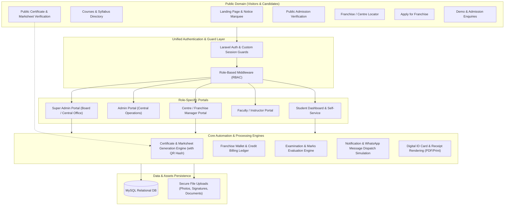

# Project Architecture & Master Plan: Drishti Computer Education

**Project Name:** Drishti Computer Education (Institute & Franchise Management System)  
**Reference Model:** Inspired by [https://drishticomputer.com/](https://drishticomputer.com/) and reference institutional workflows.  
**Architecture Document Version:** 1.0.0 (Comprehensive Plan)  
**Status:** Planning Stage (No code modifications applied yet)

---

## 1. Executive Summary & Project Vision

**Drishti Computer Education** is an enterprise-grade Computer Education Institute & Franchise Management System designed to handle multi-branch franchise operations across India. It mirrors the exact operational workflows, public web presence, and institutional credibility of Drishti Computer Education (ISO 9001:2015 Certified, registered under MCA Govt. of India and NITI Aayog).

The system seamlessly connects five major user groups:
1. **Public & Prospective Students/Centres:** Access course catalog, live demo requests, franchise applications, instant certificate/marksheet verification, admission verification, and centre locator.
2. **Super Admin (Head Office / Central Board):** Complete oversight of franchise affiliations, course catalog, fees, digital wallet/credit ledger, exam schedules, centralized marksheet/certificate issuance, and financial audit logs.
3. **Admin (Head Office Operations & Verification):** Operations handling, admission verification, exam evaluations, support ticket management, and batch coordination.
4. **Franchise / Centre Managers (Branch Heads):** Management of branch students, admission processing, fee collections & receipts, batch scheduling, marks entry, certificate requests, and branch profile maintenance.
5. **Students:** Personalized portal for digital ID card downloads, syllabus/study material access, fee status & receipt generation, exam admit cards, and direct viewing/downloading of verified marksheets and certificates.

---

## 2. Existing Environment & Tech Stack Audit

A thorough inspection of the active workspace (`c:\xampp\htdocs\schoolfrenchise`) reveals:

| Component | Detected Specification | Required / Planned Specification |
|---|---|---|
| **Framework** | Laravel Framework 12.x (`laravel/framework: ^12.0`) | Laravel 12 LTS with standard MVC & Blade conventions |
| **PHP Version** | PHP 8.2.12 (CLI & Apache compatible) | PHP 8.2+ with PDO, OpenSSL, GD/Imagick, cURL, Mbstring |
| **Database** | MySQL / MariaDB via XAMPP (127.0.0.1:3306) | MySQL 8.0+ / MariaDB 10.4+ (`frenchise` database) |
| **Existing DB Status** | Configured in `.env` as `DB_DATABASE=frenchise` (not yet created on MySQL server) | Will be created with utf8mb4 charset and strict collation |
| **Frontend Assets** | Vite 7.0.7, TailwindCSS 4 (default Laravel 12 skeleton) | **Bootstrap 5.3.3**, FontAwesome 6 / LineAwesome, jQuery 3.7.1, DataTables, Custom Modular CSS/JS |
| **Package Dependencies** | Minimal fresh Laravel 12 (`fakerphp`, `mockery`, `phpunit 11.5`) | Add necessary tools for PDF generation (DomPDF / Snappy), QR Code (BaconQrCode / SimpleSoftwareIO QrCode) |
| **Existing Code State** | Clean Laravel 12 boilerplate (default `User.php`, standard migrations) | **Zero destructive overwrites**: Build modularly upon existing structure |

---

## 3. High-Level System Architecture



---

## 4. Route Architecture & URL Map

### 4.1. Public Website & Verification Routes (`routes/web.php`)
| HTTP Method | URI | Controller & Action | Purpose |
|---|---|---|---|
| `GET` | `/` | `HomeController@index` | Institute homepage with dynamic sliders, stats, courses, facilities, demo form |
| `GET` | `/about-us` | `PageController@about` | Organization background, MCA/ISO/Niti Aayog details |
| `GET` | `/company` | `PageController@company` | Company profile & legal registrations |
| `GET` | `/chairman` | `PageController@chairman` | Chairman's message and vision |
| `GET` | `/mission` | `PageController@mission` | Mission, Vision, and Quality objectives |
| `GET` | `/courses` | `CourseController@index` | Course catalog with duration, eligibility, category filter |
| `GET` | `/course/{slug}` | `CourseController@show` | Single course syllabus details & subjects breakdown |
| `GET` | `/check-certificate-marksheet` | `VerificationController@certificateIndex` | Search form for Certificate / Marksheet verification |
| `POST` | `/check-certificate-marksheet` | `VerificationController@verifyCertificate` | Process verification by Reg. No. + Father's Name / DOB |
| `GET` | `/verify/cert/{cert_no}` | `VerificationController@directVerifyCert` | Direct QR-code destination for instant tamper-proof verification |
| `GET` | `/check-admission` | `VerificationController@admissionIndex` | Search form for student admission status |
| `POST` | `/check-admission` | `VerificationController@verifyAdmission` | Process admission search by Roll/Reg Number |
| `GET` | `/frenchise` | `FranchiseEnquiryController@create` | Apply for New Franchise registration form |
| `POST` | `/frenchise/submit` | `FranchiseEnquiryController@store` | Store franchise application with infrastructure & KYC details |
| `GET` | `/frenchise-status` | `FranchiseEnquiryController@statusIndex` | Track franchise application status by Application Reference No. |
| `POST` | `/frenchise-status` | `FranchiseEnquiryController@checkStatus` | Return current status (Under Review, Approved, Active, Rejected) |
| `GET` | `/search_centre` | `CentreLocatorController@index` | Search authorized centres by State, District, City, or Code |
| `GET` | `/api/districts/{state_id}` | `GeoController@getDistricts` | Dynamic AJAX lookup for dependent State -> District dropdowns |
| `GET` | `/gallery` | `GalleryController@index` | Photo & event gallery |
| `GET` | `/blogs` | `BlogController@index` | Institute notices, news, and technical articles |
| `GET` | `/blog/{slug}` | `BlogController@show` | Single blog / notice post |
| `GET` | `/contact-us` | `ContactController@index` | Contact details, office map, feedback form |
| `POST` | `/contact-us` | `ContactController@submit` | Save contact query |
| `POST` | `/demo-request` | `HomeController@demoRequest` | Live demo request form handler from homepage |
| `GET` | `/online-payment` | `PaymentController@publicPayIndex` | Public fee payment lookup & payment portal |

### 4.2. Authentication Routes (`routes/auth.php` or `routes/web.php`)
| HTTP Method | URI | Controller & Action | Purpose |
|---|---|---|---|
| `GET` | `/login` | `Auth\LoginController@showLoginForm` | Central login (Admin, Franchise Centre, Staff) |
| `POST` | `/login` | `Auth\LoginController@login` | Authenticate management users |
| `GET` | `/student` | `Auth\StudentAuthController@showLoginForm` | Student dedicated login portal |
| `POST` | `/student/login` | `Auth\StudentAuthController@login` | Student authentication (Reg No / Roll No + Password) |
| `POST` | `/logout` | `Auth\LoginController@logout` | Terminate session and invalidate guard |
| `GET` | `/password/reset` | `Auth\ForgotPasswordController@showLinkRequestForm` | Password reset request |

### 4.3. Super Admin & Head Office Admin Routes (`routes/admin.php`, prefix `admin`, middleware `auth`, `role:super-admin|admin`)
| URI Pattern | Controller | Key Capabilities |
|---|---|---|
| `admin/dashboard` | `Admin\DashboardController` | Central KPI dashboard: centres, active students, collections, pending approvals |
| `admin/centres/**` | `Admin\FranchiseController` | CRUD centres, issue centre codes (e.g. DCE-101), approve franchise KYC, affiliation certs |
| `admin/wallet/**` | `Admin\WalletController` | Centre wallet ledger, manually credit/debit balance, approve top-up requests |
| `admin/courses/**` | `Admin\CourseController` | Manage course categories, courses, durations, syllabus, subject papers & marks rules |
| `admin/students/**` | `Admin\StudentController` | Master student directory across all centres, admission approval, ID card printing |
| `admin/batches/**` | `Admin\BatchController` | Master view of batches running across all franchise locations |
| `admin/fees/**` | `Admin\FeeController` | Financial reports, royalty/registration dues, centre-wise revenue aggregation |
| `admin/exams/**` | `Admin\ExamController` | Exam schedules, hall ticket/admit card release, master grade rules |
| `admin/marks/**` | `Admin\MarksController` | Review marks uploaded by centres, approve/reject results before final generation |
| `admin/certificates/**` | `Admin\CertificateController` | Master certificate & marksheet issuance, serial number allotment, batch print |
| `admin/enquiries/**` | `Admin\EnquiryController` | Manage demo requests, admission enquiries, contact messages |
| `admin/cms/**` | `Admin\CmsController` | Sliders, gallery photos, notices, blog posts, corporate team profiles |
| `admin/settings/**` | `Admin\SettingController` | Institute info (CIN, ISO, Niti Aayog), director signature upload, notification templates |

### 4.4. Franchise / Centre Manager Routes (`routes/centre.php`, prefix `centre`, middleware `auth`, `role:centre`)
| URI Pattern | Controller | Key Capabilities |
|---|---|---|
| `centre/dashboard` | `Centre\DashboardController` | Centre metrics, wallet balance, active admissions, upcoming exams |
| `centre/profile` | `Centre\ProfileController` | Centre details, lab infrastructure photos, affiliation certificate download |
| `centre/students/**` | `Centre\StudentController` | Direct student admission, photo/signature upload, auto registration code |
| `centre/students/{id}/id-card` | `Centre\StudentController@idCard` | Print student identity card with QR code |
| `centre/batches/**` | `Centre\BatchController` | Create morning/afternoon batches, assign students, track attendance |
| `centre/fees/**` | `Centre\FeeController` | Collect student fee installments, issue computerized GST/Standard receipts |
| `centre/exams/**` | `Centre\ExamController` | View scheduled board exams, download student admit cards |
| `centre/marks/**` | `Centre\MarksController` | Enter student theory/practical marks, submit to central board for approval |
| `centre/certificates` | `Centre\CertificateController` | Request certificate issuance, track dispatched/issued marksheets & certs |
| `centre/wallet/**` | `Centre\WalletController` | View transaction history, submit top-up request, download receipts |
| `centre/prospectus` | `Centre\ProspectusController` | Generate personalized student prospectus with branch stamp & WhatsApp delivery |

### 4.5. Student Portal Routes (`routes/student.php`, prefix `student`, middleware `auth:student`, `role:student`)
| URI Pattern | Controller | Key Capabilities |
|---|---|---|
| `student/dashboard` | `Student\DashboardController` | Enrolled course status, attendance %, recent notices, payment summary |
| `student/profile` | `Student\ProfileController` | View student bio, change password, update basic contact info |
| `student/id-card` | `Student\IdCardController` | Download official digital ID Card with QR code |
| `student/course` | `Student\CourseController` | View course syllabus, topics, and downloadable study material |
| `student/fees` | `Student\FeeController` | Fee schedule, ledger of paid installments, download payment receipts |
| `student/admit-card` | `Student\ExamController@admitCard` | Download exam hall ticket with candidate photo & exam instructions |
| `student/results` | `Student\ResultController` | View subject-wise marks, grades, and percentage |
| `student/certificate` | `Student\CertificateController` | View and download verified Certificate & Marksheet |

---

## 5. Role-Based Access Control (RBAC) & Permission Matrix

The application employs strict Role-Based Access Control enforcing boundary isolation between branches:

```
+---------------------------+-------------+-------+----------------+-------+---------+
| Capability                | Super Admin | Admin | Centre Manager | Staff | Student |
+---------------------------+-------------+-------+----------------+-------+---------+
| System Settings & Branding|     YES     |   NO  |       NO       |   NO  |   NO    |
| Create & Manage Centres   |     YES     |  VIEW |       NO       |   NO  |   NO    |
| Centre Wallet Credit Adjustment|YES    |   NO  |       NO       |   NO  |   NO    |
| Manage Master Courses & Fees|   YES     |  EDIT |      VIEW      |  VIEW |  VIEW   |
| View All Centres Data     |     YES     |  YES  |       NO       |   NO  |   NO    |
| Admit Students            |     YES     |  YES  |   OWN CENTRE   |   NO  |   NO    |
| Collect Fees & Print Slip |     YES     |  YES  |   OWN CENTRE   |   NO  |   NO    |
| Manage Batches & Attendance|    YES     |  YES  |   OWN CENTRE   |  YES  |   NO    |
| Upload / Enter Marks      |     YES     |  YES  |   OWN CENTRE   |  YES  |   NO    |
| Final Certificate Approval|     YES     |  YES  |       NO       |   NO  |   NO    |
| Print/Download Marksheets |     YES     |  YES  |   OWN CENTRE   |   NO  | OWN DOC |
| Download Own ID Card      |     YES     |  YES  |   OWN CENTRE   |   NO  |   YES   |
| CMS & Notice Board Manage |     YES     |  YES  |       NO       |   NO  |   NO    |
+---------------------------+-------------+-------+----------------+-------+---------+
```

### Multi-Tenancy Scoping Rule:
- Centre Managers and Staff are strictly scoped via `centre_id`. Eloquent Global Scopes or query scopes will ensure a Centre Manager cannot view, edit, or leak student, financial, or academic records belonging to another centre.

---

## 6. Core Business Workflows

### 6.1. Student Admission & Auto-Code Generation
1. Centre Manager fills Student Admission Form: Name, Parentage, DOB, Gender, Mobile, Email, Full Address, Qualification, Course selected, Batch allocated.
2. Secure upload of: Student Photo (JPEG/PNG max 1MB), Signature, and Qualification Document.
3. System assigns:
   - Unique Registration Number: `DCE/{YEAR}/{CENTRE_CODE}/{SEQUENCE}` (e.g. `DCE/2026/101/0045`)
   - Unique Roll Number: `DCE{YY}{RANDOM_6_DIGIT}`
   - Initial Student Portal login credentials automatically generated.
4. Auto-generation of printable Student ID Card with QR code pointing to `/check-admission`.
5. Immediate WhatsApp notification log entry dispatched to the student's mobile with their admission confirmation and login credentials.

### 6.2. Fee Collection & Payment Receipt Flow
1. Course Fee structure is defined (One-time or Installments).
2. Centre Manager records an incoming installment payment (Cash / UPI / Online / Bank Transfer).
3. Transaction recorded in `student_fees` and `fee_payments` tables with unique Invoice/Receipt number (e.g. `RCP-2026-00892`).
4. Instant generation of computerized, print-friendly Fee Receipt containing Centre details, Student details, payment mode, amount paid, and outstanding balance.
5. WhatsApp notification triggered informing the student/parent of fee clearance.

### 6.3. Examination, Marks Entry & Grading System
1. Admin schedules an examination session for designated courses.
2. Centres download student Admit Cards (Hall Tickets) containing exam date, time, roll number, and exam center rules.
3. After examination, Centre/Staff inputs subject-wise marks (Theory, Practical, Viva).
4. System validates total marks, pass marks, and computes:
   - Total Marks Obtained / Maximum Marks
   - Percentage
   - Grade according to board standards:
     * $\ge 85\%$: Grade **A+** (Distinction)
     * $75\% - 84\%$: Grade **A** (First Division with Distinction)
     * $60\% - 74\%$: Grade **B** (First Division)
     * $50\% - 59\%$: Grade **C** (Second Division)
     * $40\% - 49\%$: Grade **D** (Pass)
     * $< 40\%$: **Failed**
5. Admin reviews and approves the marks submission.

### 6.4. Certificate & Marksheet Issuance with QR Verification
1. Upon Admin approval and fee clearance, the system issues:
   - **Certificate Number** (e.g. `DCE/CERT/2026/89421`)
   - **Marksheet Serial Number** (e.g. `DCE/MS/2026/10294`)
   - Issue Date & Verification Token / Hash.
2. Dynamic QR Code rendered directly onto the Certificate and Marksheet documents pointing directly to:  
   `https://drishticomputer.com/verify/cert/{cert_no}`.
3. Anyone scanning the QR code or visiting `/check-certificate-marksheet` enters Registration No. and Father's Name to immediately view verified details:
   - Student Full Name & Candidate Photo
   - Course Name & Duration
   - Issuing Centre Name & Centre Code
   - Marks Obtained, Percentage, Grade & Issue Date
   - Security Watermark & Official Verification Seal.

---

## 7. Reusable UI Component System

To ensure consistency across the public website and role portals, the application will follow a clean Blade component hierarchy:

```
resources/views/
├── components/
│   ├── alert.blade.php                 # Flash messages (success, warning, danger)
│   ├── badge-status.blade.php          # Status badges (Active, Pending, Suspended)
│   ├── breadcrumb.blade.php            # Dynamic breadcrumb navigation
│   ├── card-stat.blade.php             # Dashboard KPI metric cards
│   ├── data-table.blade.php            # Bootstrap 5 styled table with pagination
│   ├── modal-confirm.blade.php         # Reusable deletion/action confirmation modal
│   ├── form-input.blade.php            # Form inputs with validation error binding
│   ├── form-select.blade.php           # Select inputs with search/options
│   ├── print-header.blade.php          # Institutional header for printable docs
│   └── qr-code.blade.php               # Embedded SVG/PNG QR code generator
├── layouts/
│   ├── app.blade.php                   # Public website master layout
│   ├── admin.blade.php                 # Super Admin & Central Office layout
│   ├── centre.blade.php                # Franchise / Centre Manager layout
│   ├── student.blade.php               # Student portal master layout
│   └── print.blade.php                 # Dedicated `@media print` clean layout
```

### Key UI Features:
- **Public Website Theme:** Navy blue (`#07294d`), Royal Blue (`#14599e`), Vibrant Accent (`#ffc107` / `#25D366`), matching the visual identity of `drishticomputer.com`.
- **Admin & Centre Dashboards:** Modern responsive sidebar, sticky header, stat cards, quick search, exportable data tables, and print buttons.
- **Mobile First & Responsive:** Works smoothly on desktop, tablet, and mobile browsers with touch-friendly navigation toggles.

---

## 8. Security & File Upload Architecture

1. **Authentication & Session Security:**
   - Password hashing with Bcrypt (cost factor 12).
   - Rate limiting on all login routes (`throttle:6,1`).
   - CSRF protection enabled on all POST/PUT/DELETE forms.
2. **File Upload Security:**
   - Permitted mime-types: `image/jpeg, image/png, image/webp, application/pdf`.
   - Max file size limits enforced in Form Requests (Photos $\le 1\text{MB}$, Documents $\le 2\text{MB}$).
   - Stored in `storage/app/public/` under categorized folders:
     * `photos/students/`
     * `signatures/students/`
     * `documents/students/`
     * `documents/centres/`
     * `cms/`
   - Generated file names hashed with UUIDs to prevent directory traversal or file execution attacks.
3. **Data Protection & Tamper Resistance:**
   - Marksheet and Certificate verification hashes generated with SHA-256 preventing tampering or falsification.
   - Public verification does not expose private contact information (mobile numbers / full address are masked).

---

## 9. Preservation & Integration Notice
- The existing Laravel 12 directory structure, `composer.json`, `.env`, and base configurations are strictly preserved.
- No existing working files are overwritten destructively.
- Database creation and migrations will be staged progressively in the subsequent execution phases.
